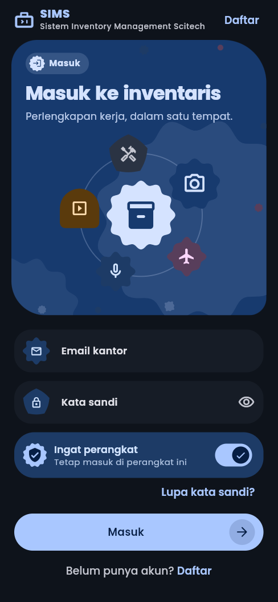
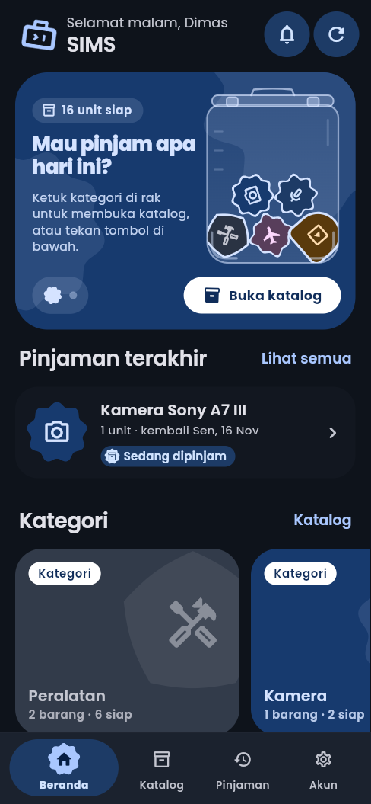
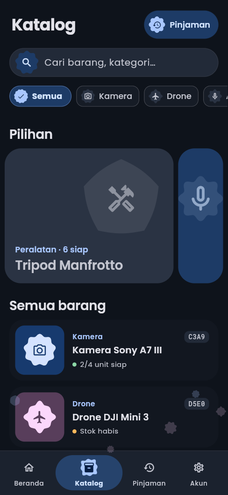
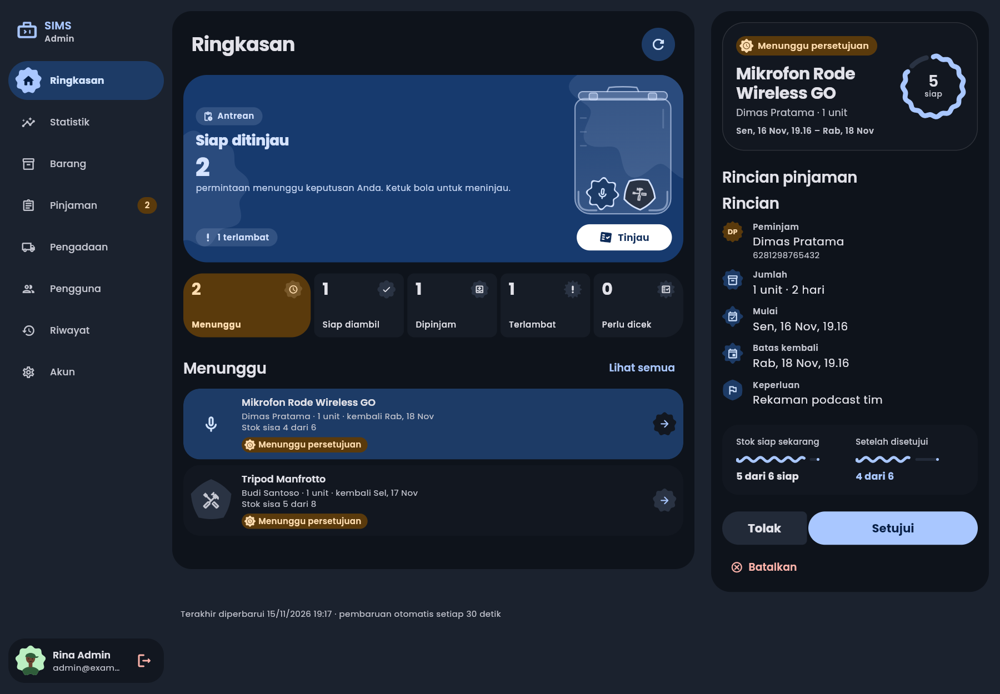
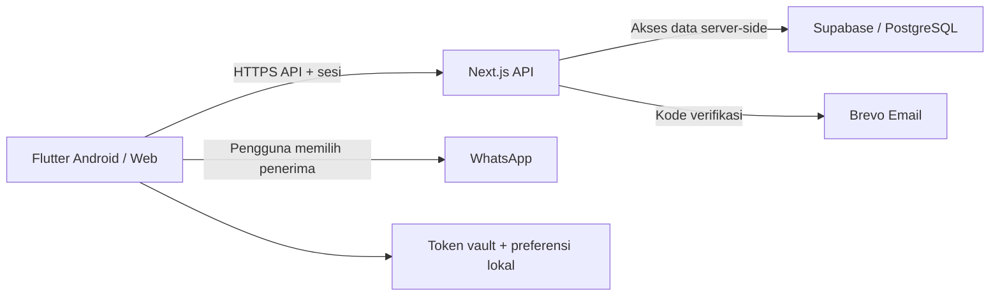
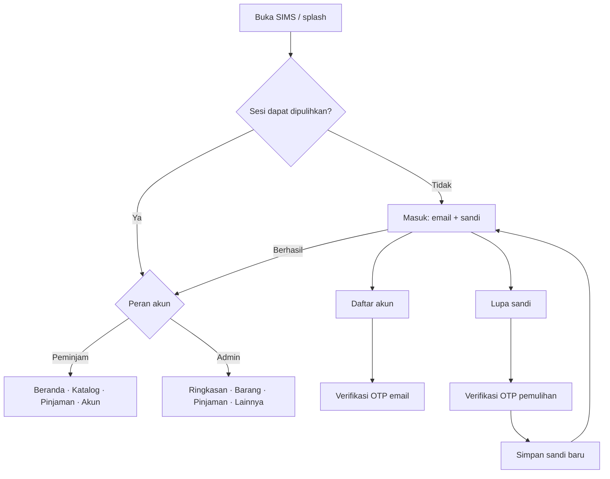
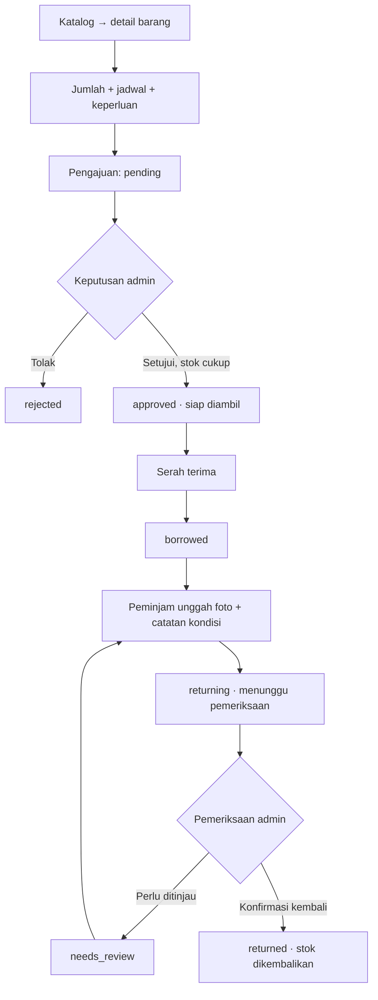

# SIMS — Sistem Inventory Management Scitech

Aplikasi inventaris dan peminjaman internal Scitech: staf mencari perlengkapan, mengajukan pinjaman, dan mengirim bukti pengembalian; admin mengelola stok, persetujuan, serah terima, pengguna, dan pengadaan.

**Versi aplikasi:** `1.0.0+3` · **UI terkini:** V11.2, Material 3 Expressive · **Dokumentasi:** 15 November 2026.

Client produksi menggunakan **Flutter**, dengan backend **Next.js API + Supabase/PostgreSQL**. Android dan browser memakai sumber UI yang sama; antarmuka web standalone lama tidak disertakan.

## Screenshot UI terbaru

Tangkapan **Flutter Web** dari build sumber terkini, 15 November 2026, dalam **mode gelap**: viewport ponsel 390×844 dan desktop 1440×1000. Preview memakai **fixture lokal/data contoh**, bukan data operasional dan bukan bukti koneksi ke layanan produksi. Screenshot lama di `app_inventory/docs/screenshots/ui-redesign/after-*` berasal dari iterasi sebelumnya; tidak mewakili UI V11.2.

### Peminjam · tampilan ponsel

<p>
  
  
  
</p>

### Admin · tampilan desktop



## Fitur aplikasi

| Area | Kemampuan |
|---|---|
| Autentikasi | Masuk email + sandi, ingat perangkat, daftar akun dengan verifikasi OTP, pemulihan sandi melalui OTP |
| Beranda peminjam | Sapaan pengguna, stok tersedia, ringkasan pinjaman, peti kategori interaktif |
| Katalog | Pencarian, filter kategori, foto, ID pendek, jumlah tersedia, detail barang, aktivitas rekan dengan data terbatas |
| Pengajuan | Pilih barang, jumlah, jadwal pinjam/kembali, keperluan, lalu lihat ringkasan pengajuan |
| Pinjaman | Status permintaan, serah terima, pengembalian dengan foto kondisi/catatan, tindak lanjut WhatsApp |
| Ringkasan admin | Antrean permintaan, persetujuan/penolakan, pemantauan pinjaman dan pengembalian |
| Pengelolaan | Barang dan foto, ketersediaan stok, pengadaan, pengguna, riwayat, serta statistik |
| Akun | Edit profil, avatar/foto lokal per akun, ganti sandi, tema, ukuran teks, kurangi gerak, pengaturan aplikasi |
| Pembaruan | Pemberitahuan versi, pemeriksaan APK Android, dan pembaruan browser; memerlukan artefak rilis yang benar-benar dipublikasikan |

### Desain dan interaksi

- **Merek:** SIMS Kit Case, Navy Scitech `#0F2C59`, latar slate sejuk, Poppins 400–800, Roboto Mono untuk ID.
- **Material 3 Expressive:** hero berwarna, bentuk kategori, grup baris tersambung, input tonal, indikator progres bergelombang, morph tombol, dan animasi pegas.
- **Tema:** tujuh palet, mode sistem/terang/gelap, kontras, warna dinamis Android 12+ bila didukung.
- **Adaptif:** dock pada ponsel, rail mulai lebar 900 px, daftar–detail admin pada layar lebar.
- **Feedback:** respons tekan/haptic, transisi tab, ilustrasi interaktif; animasi sukses hanya setelah operasi berhasil.
- **Keyboard:** form dapat digulir; fallback inset IME native untuk Android <30 ketika metrik Flutter nol. Preferensi kurangi gerak tetap mempertahankan fungsi kontrol.

Detail komponen dan struktur Flutter ada di [README aplikasi](app_inventory/README.md). [Spesifikasi desain](DESIGN.md), [panduan logo](app_inventory/assets/brand/kit/sims-logo-guidelines.md), dan [riwayat perubahan UI](app_inventory/docs/ui-redesign.md) tersedia terpisah.

## Tech stack

Versi berikut berasal dari manifest repository, bukan klaim versi terbaru upstream.

| Lapisan | Teknologi | Peran |
|---|---|---|
| Client | Flutter, Dart SDK `^3.11.0`, Material | UI Android/web dan lokalisasi |
| State & jaringan | `AppState`, `http` | State aplikasi dan request ke API |
| Penyimpanan perangkat | `flutter_secure_storage`, `shared_preferences` | Token sesi dan preferensi lokal |
| Media & integrasi | `image_picker`, `image`, `url_launcher`, `dynamic_color` | Foto/kompresi, WhatsApp, warna sistem |
| API | Next.js `16.4.2`, TypeScript `5.9.3`, Node.js `24.x` | Route handlers, autentikasi, aturan bisnis, akses data |
| Runtime web server | React / React DOM `19.2.5` | Dependensi Next.js; UI utama tetap Flutter |
| Data | Supabase, PostgreSQL, `@supabase/supabase-js` `2.118.0` | Penyimpanan data melalui backend |
| Email | Brevo | Pengiriman kode verifikasi/pemulihan dari server |
| Validasi | Zod `4.6.7` | Validasi input API |
| Pengujian | Flutter Test, Vitest `5.0.5`, PGlite, ESLint | Regresi client/server dan pemeriksaan sumber |

### Arsitektur



Credential privat Supabase dan Brevo hanya berada di server. Flutter tidak memuat service key. Server memeriksa akses akun, pinjaman, dan gambar; aktivitas rekan tidak menyertakan kontak privat, catatan, atau foto kondisi.

## App flow

### Masuk dan akses per peran



OTP bukan metode masuk alternatif. Admin mengakses Statistik, Pengadaan, Pengguna, Riwayat, dan Akun melalui navigasi workspace; ponsel mengelompokkan tujuan tambahan di **Lainnya**.

### Siklus peminjaman



Stok dikurangi saat persetujuan dan dikembalikan saat admin mengonfirmasi pengembalian. Server tetap menentukan validitas transisi dan kecukupan stok. Status terlambat serta pembatalan tersedia di jalur yang diizinkan API; diagram menampilkan jalur utama.

## Menjalankan lokal

Prasyarat: Node.js 24, npm ≥10, Flutter dengan Dart sesuai `pubspec.yaml`, dan konfigurasi Supabase/Brevo.

Dari root repository:

```sh
npm ci
# Konfigurasi .env.local berdasarkan .env.example; jangan commit credential.
npm run dev
```

Untuk proyek Supabase baru, terapkan `supabase/bootstrap_sams.sql`, lalu `supabase/transition_setup.sql`. Jika query statis berubah, jalankan `npm run db:prepare`, tinjau allowlist yang dihasilkan, lalu terapkan sebelum merilis API.

Dari `app_inventory`:

```sh
flutter pub get
flutter run -d chrome --web-port=5173 --no-web-resources-cdn
```

API lokal memakai port 3000. Build native rilis harus diberi `--dart-define=API_URL=https://YOUR-API-DOMAIN`; URL tersebut harus dapat dijangkau perangkat. Web rilis memakai origin yang sama kecuali `API_URL` ditetapkan.

### Build web satu origin

Dari `app_inventory`:

```sh
flutter build web --release --base-href=/app/ --no-web-resources-cdn
```

Kemudian dari root:

```sh
node scripts/bundle-flutter.mjs
npm run check:release
npm run build
npm run start
```

Kontak dukungan berada di `lib/backend/admin-contacts.ts`. Pengguna memilih penerima sebelum WhatsApp dibuka; membuka WhatsApp tidak berarti pesan otomatis terkirim.

## Distribusi dan pembaruan APK

Pertahankan application ID dan signing key privat yang sama sejak APK pertama didistribusikan. Salin `app_inventory/android/key.properties.example` menjadi `key.properties` secara lokal dan konfigurasi keystore. Jangan commit keduanya. Build rilis menolak debug signing; APK bertanda tangan debug tidak dapat diperbarui memakai signer rilis yang berbeda.

Setiap pembaruan memerlukan build number lebih tinggi. Contoh untuk rilis berikutnya:

    node scripts/set-app-version.mjs 1.0.1+4

Build APK bertanda tangan dari `app_inventory`, memakai origin API HTTPS yang sudah di-deploy:

    flutter build apk --release --dart-define=API_URL=https://YOUR-API-DOMAIN

Dari root repository, siapkan distribusi memakai `aapt` dan `lib/apksigner.jar` dari Android build-tools:

    node scripts/prepare-android-release.mjs app_inventory/build/app/outputs/flutter-apk/app-release.apk /path/to/aapt /path/to/lib/apksigner.jar

Publikasikan direktori `public/releases` yang dihasilkan bersama API pada origin HTTPS yang sama. APK hasil build tidak masuk Git. Feed pembaruan tetap tidak tersedia sampai APK bertanda tangan dan metadata yang cocok benar-benar tersedia.

Aplikasi menampilkan pemberitahuan versi dan menu **Akun > Pembaruan aplikasi**. APK diunduh ke cache privat; origin HTTPS, ukuran, SHA-256, package ID, version code lebih tinggi, dan sertifikat signing diperiksa sebelum membuka installer sistem Android. Pengguna tetap memberi izin instalasi dan mengonfirmasi pemasangan. Aplikasi tidak melewati keamanan Android atau menghapus aplikasi lama. Pembaruan browser memuat ulang aplikasi tanpa menghapus penyimpanan akun.

## Verifikasi dan batas rilis

Verifikasi pada 15 November 2026: **`flutter test` — 42 tes lulus**. Hasil ini bukan pengujian end-to-end terhadap Supabase/Brevo produksi.

Perintah pemeriksaan tambahan berikut tersedia; bukan klaim bahwa semuanya dijalankan ulang pada pembaruan dokumentasi ini:

```sh
npm test
npm run typecheck
npm run lint
npm run check:services
cd app_inventory
flutter analyze --no-pub
flutter test
```

Catatan UI mencatat pengujian APK debug di Redroid Android 8.1, termasuk keyboard native. Perangkat fisik, kamera, warna dinamis, dan instalasi APK rilis tetap memerlukan pemeriksaan sesuai lingkungan distribusi.

Push repository **tidak** men-deploy backend atau menerbitkan APK. Distribusi memerlukan backend HTTPS, signing key privat yang konsisten, serta APK bertanda tangan dan metadata yang di-host. ENV, keystore, artefak APK, dan build lokal tidak boleh masuk Git.
