# Perubahan UI SIMS Scitech

Catatan ini membandingkan tampilan pada branch `SIMS-v1.0` dengan base `316f664` dari upstream `SIMS-v1.0`. Fokus perubahan ada pada aplikasi Flutter di `app_inventory`, identitas web, dan penyajian data yang sudah tersedia. Perubahan ini tidak menambah endpoint backend atau mengubah skema database.

## Yang berubah

### Login dan formulir pada layar pendek

Halaman autentikasi memakai area navy berlogo Scitech dan ilustrasi label aset, lalu formulir putih. Pada lebar mulai 900 px, atau landscape mulai 600 px, kedua area berdampingan. Formulir desktop memiliki scroll sendiri.

Pada ponsel, hero dan formulir berada dalam satu `SingleChildScrollView`. Sheet formulir mempunyai tinggi minimum, bukan batas tinggi maksimum, sehingga mode kata sandi, pesan validasi, dan keyboard dapat menambah kebutuhan ruang. Baris ingat sesi dan pemulihan memakai `Wrap`. Tujuannya menjaga tombol masuk tetap dapat dijangkau, bukan mengecilkan isi formulir agar muat paksa.

`test/password_registration_test.dart` memuat regresi viewport 360×640 dengan inset keyboard 280 px. Keberadaan kasus uji ini berbeda dari bukti bahwa pengiriman OTP atau login backend telah diuji.

### Identitas dan komponen bersama

Navy `#0F2C59` dipakai untuk header, navigasi aktif, dan aksi utama. Latar kertas `#F3F2EE` membedakan halaman dari kartu putih. Oranye menandai tenggat dan tindakan yang menunggu; status juga ditulis sebagai teks.

Motif label aset muncul pada kartu katalog, detail, dan pengajuan. ID pendek berasal dari record melalui `shortId()`, bukan kode inventaris baru. Fira Sans dan IBM Plex Mono dibundel bersama aplikasi. Layar muat browser, favicon, ikon PWA, dan warna tema Next.js mengikuti identitas yang sama.

### Alur peminjam dan admin

- **Peminjam:** cari barang lewat nama, kategori, atau deskripsi; saring kategori dan ketersediaan; buka detail barang; lanjutkan pengajuan. Katalog juga menampilkan pinjaman aktif dan barang yang sedang dipakai rekan.
- **Admin:** tinjau permintaan, setujui atau tolak, kelola inventaris, pengguna, dan pengadaan, lalu lihat ringkasan statistik. Swipe ke kanan adalah pintasan persetujuan, dengan tombol Setujui/Tolak tetap tersedia.
- **Navigasi:** peminjam memakai navigasi bawah di ponsel, admin memakai drawer. Pada layout lebar, keduanya memakai rail navy di samping konten.

Penyajian ulang ini memakai state dan aksi aplikasi yang sudah ada. Screenshot tidak membuktikan transaksi sungguhan berhasil tersimpan.

### Gerak yang mengikuti interaksi

`lib/ui/springs.dart` membagi gerak menjadi `snappy` (stiffness 500, damping 30), `bouncy` (300, 16), dan `gentle` (180, 27), semuanya bermassa 1. Tombol memberi umpan balik skala 0,96 saat ditekan; sheet membuka dengan pegas, lalu menutup dengan `easeInCubic` 220 ms. Daftar muncul dengan jeda bertahap yang dibatasi indeksnya.

Kartu persetujuan mengikuti seretan ke kanan. Jika melewati 40% lebar kartu atau kecepatan 800 px/detik, kartu menjalankan aksi persetujuan yang sama dengan tombol. Seretan di bawah ambang kembali dengan pegas; seretan ke kiri tidak menyetujui.

Saat `MediaQuery` meminta animasi dinonaktifkan, komponen yang memeriksa `reducedMotion(context)` melewati skala, translasi, dan overshoot. Screenshot diam hanya menunjukkan hasil layout, bukan bukti perilaku animasi atau reduced motion.

### Statistik dari data yang sudah dimuat

`AdminStats.from` menghitung statistik dari daftar barang, pinjaman, pengadaan, dan pengguna di aplikasi. Tidak ada endpoint statistik baru. Grafik dibuat dengan widget dan painter Flutter, tanpa library chart pihak ketiga.

Pemilih 7, 30, atau 90 hari membatasi pinjaman berdasarkan tanggal mulai pinjam. Jumlah permintaan, unit, barang teratas, persentase disetujui, dan rata-rata rencana lama pinjam mengikuti periode tersebut. Persentase disetujui hanya menghitung permintaan yang sudah diputuskan; permintaan menunggu tidak masuk penyebut.

Donat pinjaman terbuka, stok per kategori, nilai pengadaan per status, dan jumlah pengguna aktif menggambarkan data saat ini, bukan semuanya mengikuti periode. “Pengguna aktif” berarti flag akun `active`, bukan pengguna yang baru-baru ini membuka aplikasi. Rata-rata lama pinjam adalah rencana tanggal kembali dikurangi tanggal pinjam, bukan durasi pengembalian aktual.

Grafik garis memuat jumlah pinjaman harian, rata-rata, hari puncak, dan pembacaan tanggal lewat sentuh/hover. Donat menampilkan status pinjaman terbuka. Batang menampilkan barang teratas, stok siap/dipakai per kategori, dan nilai pengadaan.

## Screenshot

Gambar memperlihatkan rendering aplikasi, bukan ekspor mockup desain. Angka dan isi pada tangkapan layar area kerja memakai data contoh untuk dokumentasi, bukan catatan operasi nyata atau data pribadi. Jangan memakai jumlah barang atau pinjaman dalam gambar sebagai laporan inventaris.

### Login sebelum dan sesudah

| Sebelum, base `316f664` | Sesudah, perubahan UI |
|---|---|
| 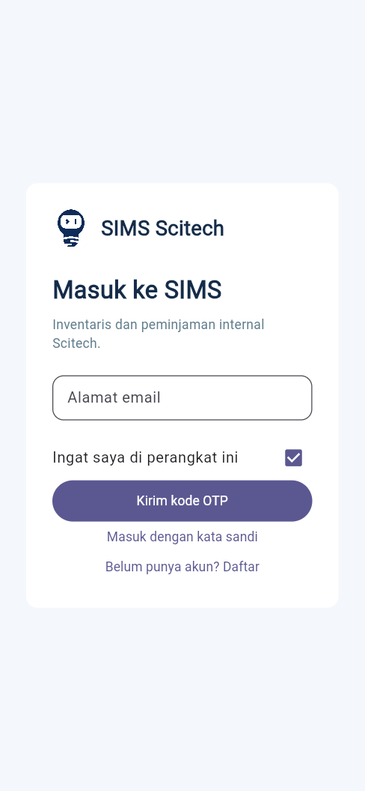 | 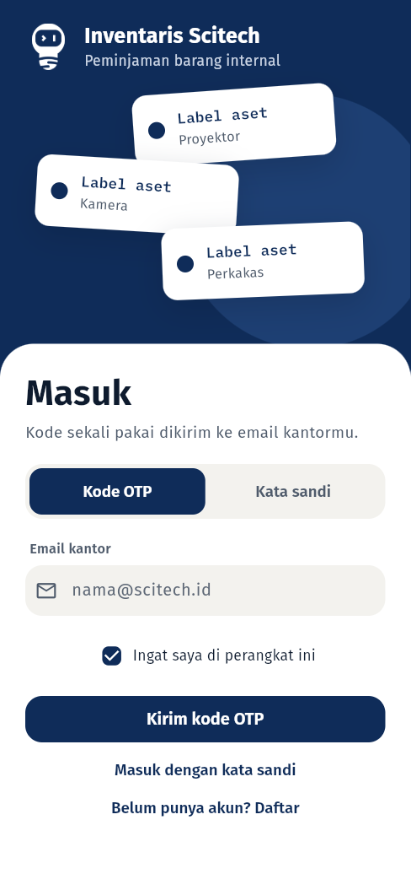 |
| Login ponsel pada base, sebagai pembanding komposisi formulir. | Login ponsel dengan identitas Scitech dan formulir dalam satu halaman yang dapat digulir. |
| 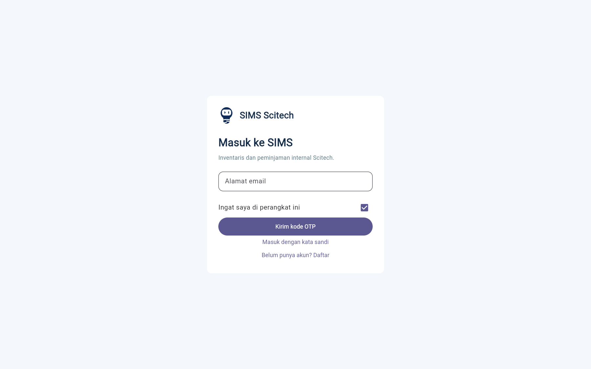 | 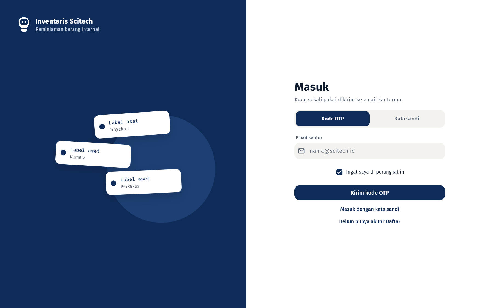 |
| Login desktop pada base. | Area merek dan formulir berdampingan pada layout lebar. |

### Area kerja sesudah perubahan

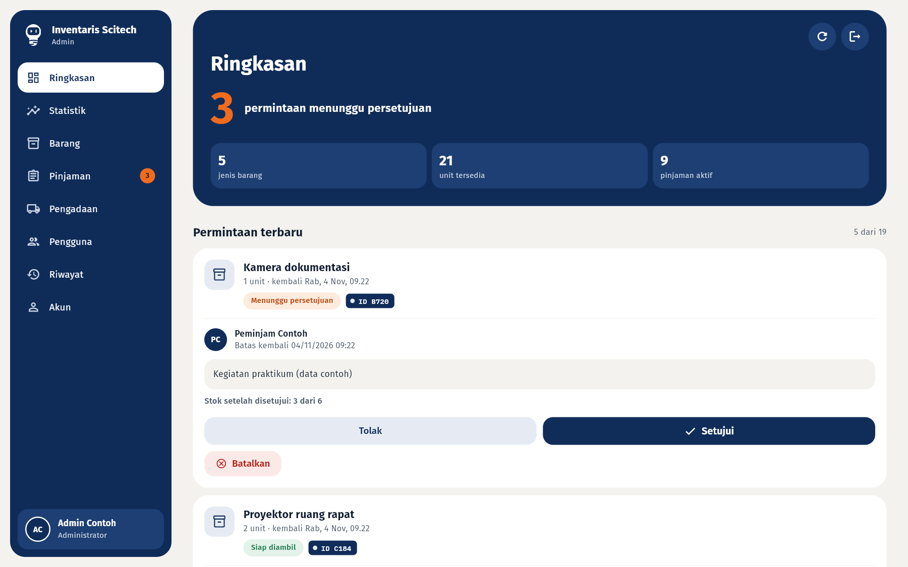

Dashboard admin: rail navigasi, ringkasan operasional, dan permintaan yang perlu ditangani.

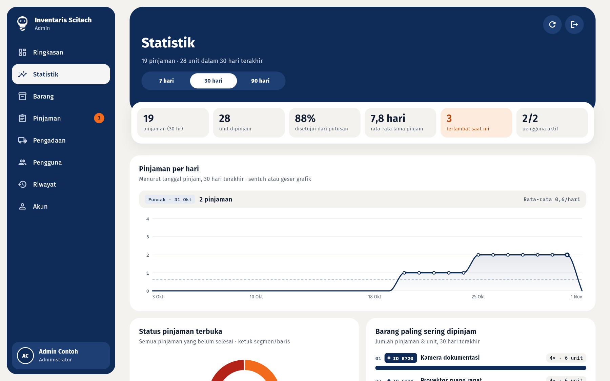

Statistik desktop: pemilih periode, angka ringkas, serta grafik dari daftar data yang dimuat aplikasi.

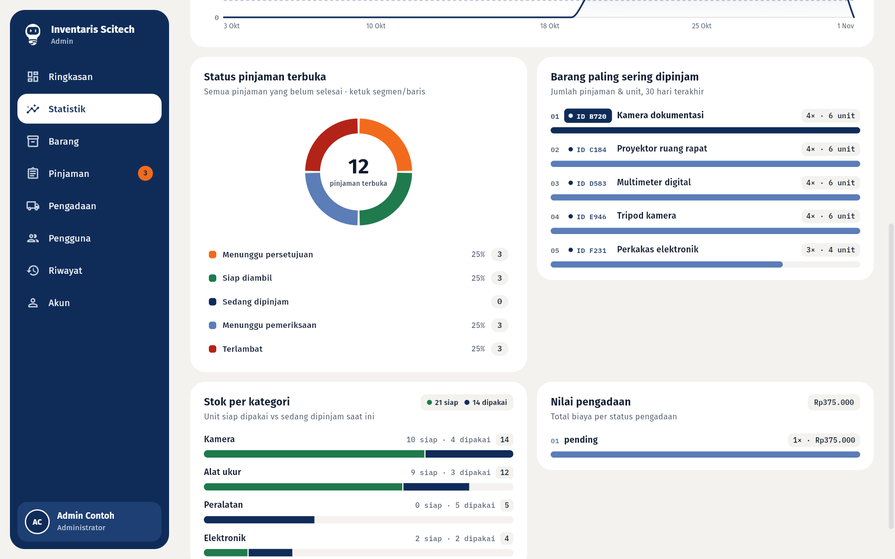

Setelah digulir: donat status, peringkat barang, stok kategori, dan nilai pengadaan.


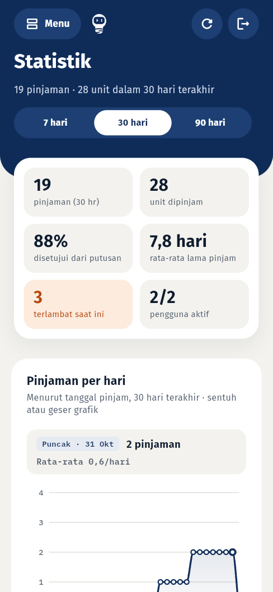

Statistik ponsel: kartu dan grafik tersusun vertikal agar detail tetap terbaca pada lebar ponsel.

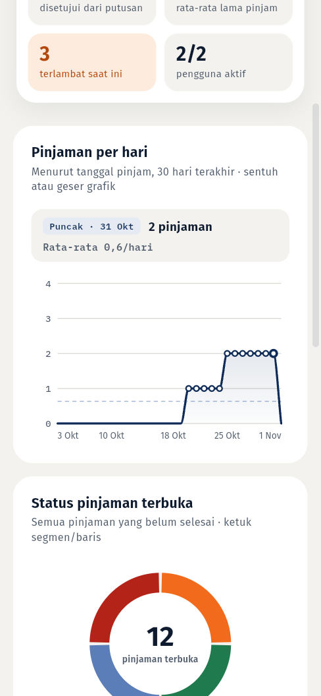

Grafik harian pada ponsel setelah digulir. Area grafik tetap memakai lebar kartu.


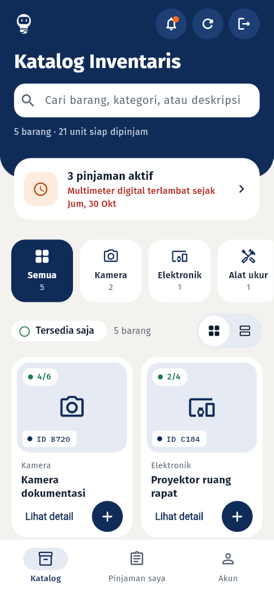

Katalog peminjam: pencarian, kategori, status ketersediaan, dan label ID barang.

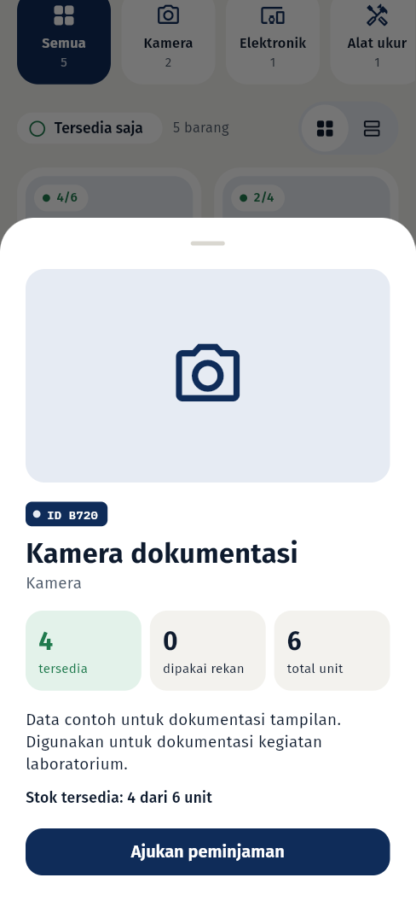

Detail barang: identitas aset, informasi stok, dan akses ke pengajuan pinjaman dalam sheet.

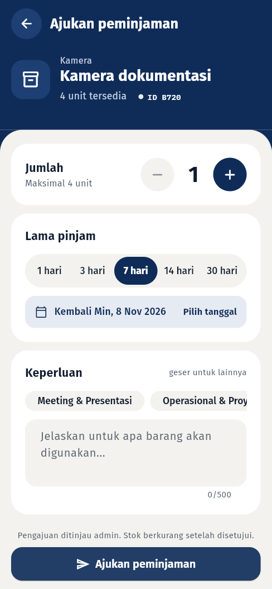

Formulir pengajuan: jumlah unit, lama pinjam, tanggal kembali, dan keperluan. Screenshot diambil sebelum pengajuan dikirim.


### Cara pengambilan gambar

Tampilan sesudah memakai entrypoint produksi `lib/main.dart`, dibangun dengan:

```sh
flutter build web --release --base-href=/ --no-web-resources-cdn
```

Hasil build disajikan oleh server lokal sementara pada `127.0.0.1:3000`, bersama respons API fixture. Tidak ada mode demo atau perubahan source produksi untuk mengambil gambar. Fixture berisi akun contoh dengan domain `example.com`, barang, dan pinjaman bertanggal relatif, tanpa foto atau kontak pribadi. Data ini hanya hidup dalam proses dokumentasi lokal.

Viewport pengambilan gambar adalah 390×844 untuk ponsel dan 1440×900 untuk desktop, dengan device scale factor 1,25. Ukuran PNG masing-masing 488×1055 dan 1800×1125 piksel. Build dokumentasi memakai base href `/` agar dapat dilayani dari root server lokal; build penempatan `/app/` tetap mengikuti README.

Baseline sebelum perubahan berasal dari arsip terisolasi commit `316f66481cca7b46a7413a442cbb43b9af20119c`. Agar source lama dapat dibangun dengan Flutter 3.47.5, salinan sementara menyembunyikan simbol `appBuildNumber` pada import `package:flutter/services.dart` di `lib/core/app_updates.dart` untuk mengatasi benturan nama. Penyesuaian kompatibilitas ini tidak mengubah layout baseline. Source kerja juga sudah memiliki penyesuaian import yang sama.

## Peta file

| Lokasi | Tanggung jawab |
|---|---|
| `lib/ui/tokens.dart`, `theme.dart`, `components.dart` | Warna, font, radius, tema, label aset, header, kartu, dan status |
| `lib/ui/springs.dart` | Preset pegas, tekan, reveal, transisi, dan preferensi reduced motion |
| `lib/production/auth/` | Layout autentikasi, formulir, dan input OTP |
| `lib/production/borrower_catalog.dart`, `catalog/` | Pencarian, filter, kartu, dan detail barang |
| `lib/production/borrow_request.dart` | Formulir serta hasil pengajuan |
| `lib/production/workspace/` | Shell responsif, dashboard, daftar kerja, dan swipe persetujuan |
| `lib/production/stats/` | Perhitungan statistik dan grafik custom |
| `test/password_registration_test.dart`, `test/admin_stats_test.dart` | Kasus regresi autentikasi dan perhitungan statistik |
| `web/`, `assets/fonts/`, `../app/layout.tsx` | Identitas browser, font lokal, dan warna tema root web |

Path pada tabel relatif terhadap `app_inventory/`. Perintah menjalankan dan membangun aplikasi ada di [README](../README.md#menjalankan-aplikasi).

## Pemeriksaan

Pemeriksaan pada perubahan ini memakai Flutter 3.47.5 dan Dart 3.13.4:

| Pemeriksaan | Hasil |
|---|---|
| `flutter analyze --no-pub` | Tidak ada masalah yang dilaporkan |
| `flutter test --no-pub` | Seluruh 24 tes lulus |
| `flutter build web --release --base-href=/ --no-web-resources-cdn` | Build release berhasil; hasilnya dipakai untuk screenshot |
| Smoke browser lokal | Login fixture admin dan peminjam, dashboard, navigasi statistik desktop/drawer ponsel, perubahan periode 30 ke 7 hari, katalog, detail barang, dan formulir pengajuan berhasil dibuka |

Build melaporkan referensi font `CupertinoIcons` yang tidak dibundel. Kompilasi tetap berhasil; tidak ada perubahan dependency ikon pada pekerjaan dokumentasi ini.

Pada fixture, pergantian periode mengubah ringkasan dari 19 pinjaman dalam 30 hari menjadi 12 pinjaman dalam 7 hari. Angka ini hanya bukti respons kontrol terhadap data contoh, bukan hasil operasi nyata. Pengajuan tidak dikirim lewat browser, dan screenshot diam tidak membuktikan seluruh interaksi.

Narasi mengikuti filter `antislop-copywriting`: perubahan disebut lewat layar dan file yang terdampak, angka pemeriksaan berasal dari hasil eksekusi, dan data contoh diberi keterangan. Tidak ada klaim peningkatan kecepatan atau produktivitas yang belum diukur.

## Batas bukti

Inspeksi source menjadi dasar penjelasan mekanisme di atas. Screenshot mencatat tampilan pada viewport yang ditangkap, bukan kelulusan semua ukuran layar. Dokumen ini tidak menyatakan backend produksi, pengiriman OTP, build rilis native, kontras seluruh komponen, atau aksesibilitas menyeluruh telah diverifikasi.
